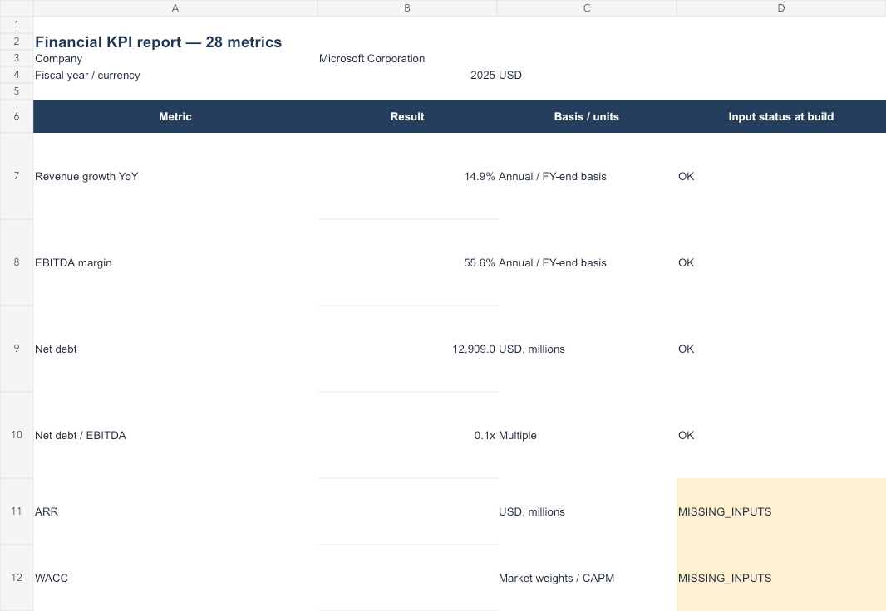

# Financial Model Automation

Turn financial source files into a traceable Excel model with **28 formula-based KPIs**.
Review uncertain evidence before it enters the model; keep the source, checks and decisions beside every value.
**Verified Microsoft FY2025 demo: 17 → 22 → 26 available metrics**, with real LibreOffice recalculation and explicit missing-data reasons.



The image shows an excerpt of the actual recalculated Report sheet, not a mockup. Reconstructed EBITDA and historical equity value are approximate. [All 84 metric checks across three cases](research/microsoft_fy2025/v03/verification.json) · [Financial definitions and limitations](docs/methodology.md)

## Quick start

Python 3.11+; developed and checked on Python 3.12. Install [uv](https://docs.astral.sh/uv/getting-started/installation/) and LibreOffice for headless Excel recalculation.

```bash
uv sync --python 3.12 --locked --extra dev
source .venv/bin/activate
python -m finmodel build --input samples/all_metrics.csv --output outputs/example.xlsx --recalculate
python research/microsoft_fy2025/replay_v03.py --overwrite
python -m pytest -q
```

The first workbook is a clearly fictional full-coverage fixture. The replay produces three historical Microsoft workbooks in `outputs/microsoft_v03/`:

| Variant | Available / 28 | What changes |
| --- | ---: | --- |
| [strict.xlsx](research/microsoft_fy2025/v03/strict.xlsx) | 17 | Strict selected reporting evidence; no inferred EBITDA or equity value |
| [ebitda.xlsx](research/microsoft_fy2025/v03/ebitda.xlsx) | 22 | Explicit operating EBIT + separate depreciation + intangible amortization |
| [ebitda_market.xlsx](research/microsoft_fy2025/v03/ebitda_market.xlsx) | 26 | Also $497.41 close on 2025-06-30 × rounded FY-end shares |

ARR and WACC remain unavailable in the expanded case. Every result and blank is independently checked against the recalculated `Calculations` and `Report` cells. The replay also changes an input in a separate copy and checks dependent formulas update. [Evidence and recipe](research/microsoft_fy2025/v03/) · [Methodology](docs/methodology.md)

Without LibreOffice, omit `--recalculate`: the workbook requests recalculation on opening and reports `FORMULA_NOT_RECALCULATED`. It does not pretend its caches are fresh. Existing output files require `--overwrite`.

## Evidence review with Jev

```text
CSV / JSON / XLSX / text PDF
           ↓
Candidates + source hash + precise location
           ↓
Python checks + six Jev semantic checks
           ↓
All checks pass → automatic approval
Uncertain/conflicting → local human review
           ↓
Approved values → existing Excel model
```

```bash
finmodel extract --input samples/all_metrics.csv --run-dir outputs/review_demo
# Configure TYPESAFE_API_KEY locally before the next command. Never commit it.
finmodel verify --run outputs/review_demo --provider jev --max-cost-usd 0.05
finmodel review --run outputs/review_demo
finmodel build --run outputs/review_demo --output outputs/reviewed.xlsx --recalculate
```

`review` opens a local page on `127.0.0.1`; on macOS it opens Safari. Accept, reject, correct mapping or select a conflicting source. Edits create a new revision and invalidate earlier verification. Source-hash failures cannot be waived by acceptance. Only approved candidates can enter `build --run`; `build --input` explicitly trusts a prepared-data boundary and still runs financial validation.

The official TypeSafe adapter pins `jev-1.13.0`. Automatic admission requires all six positive probabilities ≥0.99 and successful Python checks. **This is an experimental policy, not measured 99% accuracy.** At publication, live Jev smoke testing is **NOT_RUN** because no API key was configured. Provider behavior is tested with labelled offline fixtures; no live accuracy or cost-saving claim is made. [Workflow, costs, privacy and limitations](docs/review.md)

## Other commands and documentation

```bash
finmodel init --directory outputs/new_project
finmodel validate --input samples/all_metrics.csv --output-dir outputs/validation
finmodel batch --input-dir samples/companies --output-dir outputs/batch --recalculate
finmodel explain wacc
```

- [Financial methodology and questions: EBITDA, WACC, EV, CAGR, CCC](docs/methodology.md)
- [Prepared-data contract, units, templates, output reports and exit codes](docs/reference.md)
- [Candidate extraction, review, Jev protocol and test boundaries](docs/review.md)
- [Release verification](docs/verification.md)

Each book has seven core sheets: Inputs, Assumptions, Calculations, Report, Checks, Source_Map and Data_Dictionary. Adjacent JSON/text/CSV reports retain provenance, hashes, missing-data reasons and recalculation state. Microsoft demos add filing sources and, where applicable, derivation details.

Development was AI-assisted, including code and documentation. Financial conventions, assumptions and verification evidence are documented for review; this statement does not attribute every design decision to one person. Git history is preserved. This is a local CLI and review page, not a packaged desktop application. OCR, local OpenJev weights, a conversational assistant, FX conversion and forecast/DCF/LBO models are future work.
